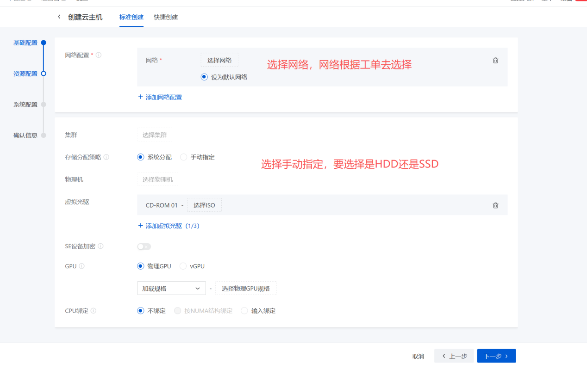
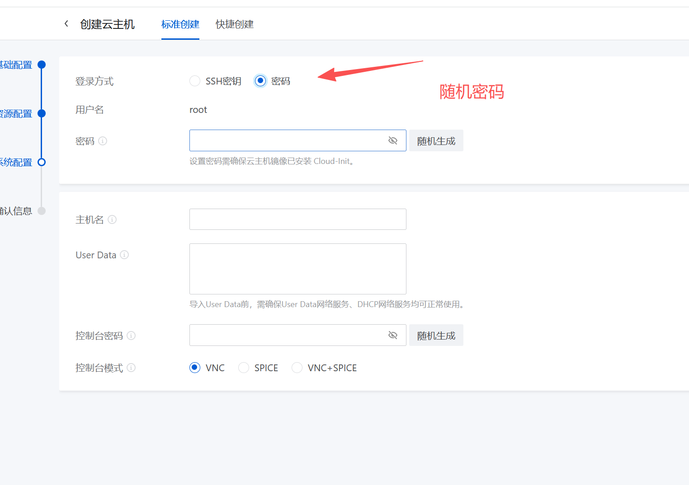
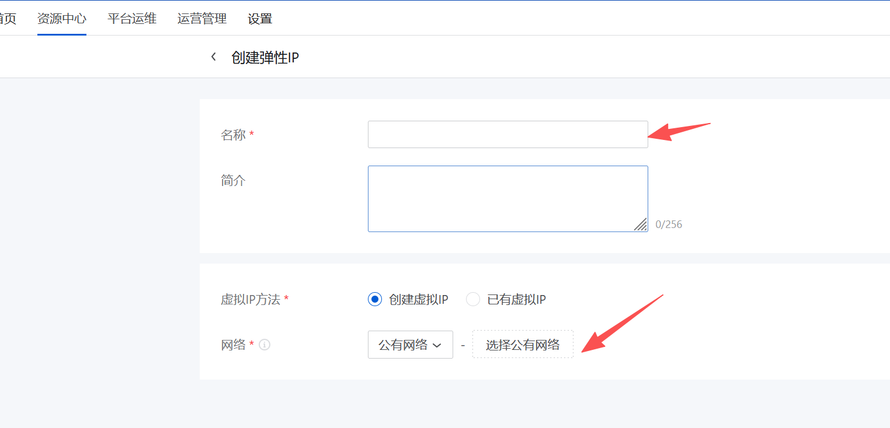

> 本文整理自《信创外网创建云主机流程》文档，含操作步骤与截图。

> 说明：本页部分截图涉及内网地址、公网 IP 或账号，已从线上移除，原件只保存在本机 `D:\AI\learndata\图片备份\cloudhost\`。需要看图请在本机打开。

外网1跟外网2主机的堡垒机是开在绿盟堡垒机上

信创外网创建云主机流程：

> 图0 截图已下线（含内网 IP 或账号信息，原件仅保存在本机）

网络就是选择VPC网络，根据合同项目选择网络

添加安全组

> 图3 截图已下线（含内网 IP 或账号信息，原件仅保存在本机）

填写安全组规则

这两条是堡垒机和扫描器的ip，端口一个是22、另外一个all

> 图4 截图已下线（含内网 IP 或账号信息，原件仅保存在本机）

查看管理者对不对，不对需要修改管理者，管理者可以看审批流程有没有经过这个人（管理局的），没有就选择其他的，有就选择yzw_xxx

更改所有者后绑定网卡

> 图6 截图已下线（含内网 IP 或账号信息，原件仅保存在本机）

可选：要加公网的情况

创建弹性IP

> 图7 截图已下线（含内网 IP 或账号信息，原件仅保存在本机）

选择公有网络

选择公网地址

> 图9 截图已下线（含内网 IP 或账号信息，原件仅保存在本机）

虚拟ip 搜索

> 图10 截图已下线（含内网 IP 或账号信息，原件仅保存在本机）

添加QoS

根据需求工单来选择填写

> 图11 截图已下线（含内网 IP 或账号信息，原件仅保存在本机）

第二部分：

> 图12 截图已下线（含内网 IP 或账号信息，原件仅保存在本机）

> 图13 截图已下线（含内网 IP 或账号信息，原件仅保存在本机）

加完记得要测试网络是否正常

> AI生成