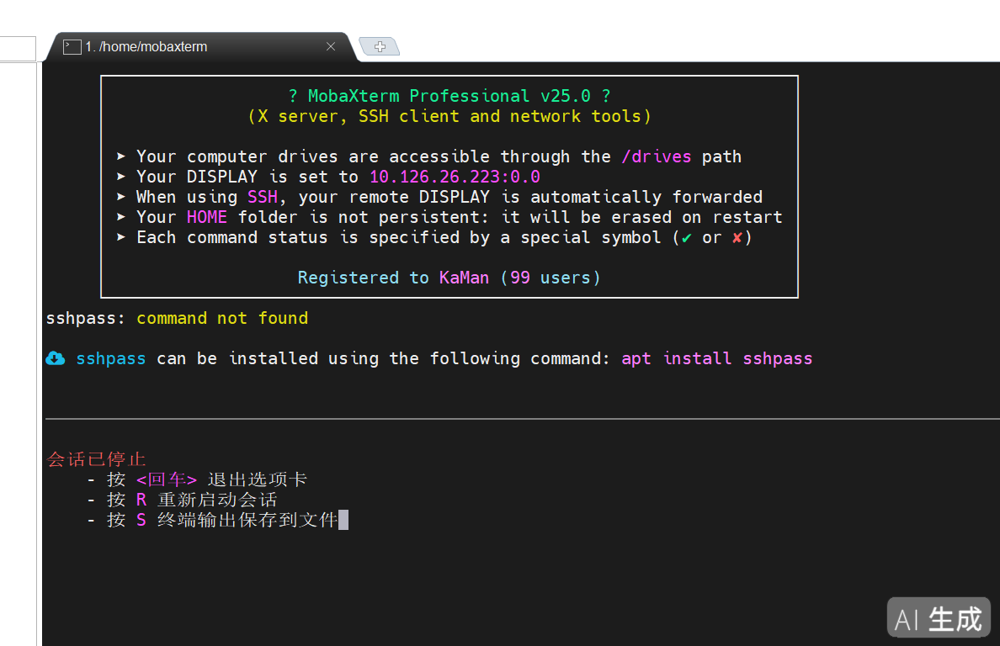

> 适用场景：从运维平台点「mobaxterm」按钮连接堡垒机 / 老服务器时，MobaXterm 终端报 `sshpass: command not found` 或算法不匹配。v25.0 双版本实测，一次配好、重启不丢。个人版与专业版操作不同，互不影响。

## 问题现象

从运维平台点「mobaxterm」按钮后，MobaXterm 终端报 `sshpass: command not found`，会话停止：



图里终端给出的官方安装命令是 `apt install sshpass`：个人版直接用它就能装好；专业版会「假成功」——先做下面第 0 步确认版本，再按 A / B 对应部分走。

## 快速导航

- [问题现象](#问题现象)
- [0 先确认你是哪个版本](#0-先确认你是哪个版本)
- [怎么找到 MobaXterm 的 bin 目录](#怎么找到-mobaxterm-的-bin-目录)
- [客户版本和你不一样怎么拿到匹配的 sshpass](#客户版本和你不一样怎么拿到匹配的-sshpass)
- [sshpass 组件库提前备好直接导入](#sshpass-组件库提前备好直接导入)
- [A 个人版](#a-个人版)
- [B 专业版](#b-专业版)
- [报错速查表](#报错速查表)
- [备选方案与回滚](#备选方案与回滚)
- [速记卡](#速记卡)

## 0 先确认你是哪个版本

只需 10 秒。在 MobaXterm 的 **Bash 终端**里执行（左侧 Sessions 点 Bash，等出现 `mobaxterm@localhost:~$` 提示符再输入）：

```bash
echo PATH=$PATH; ls /bin >/dev/null 2>&1 && echo LS_OK || echo LS_FAIL
```

| 输出 | 结论 |
| --- | --- |
| `PATH=/bin:/usr/bin…` 且 `LS_OK` | 个人版 / 便携汉化版 → 看 [A 部分](#a-个人版) |
| `PATH=` 空行，或 `LS_FAIL` | 专业版 Professional → 看 [B 部分](#b-专业版) |

::: warning
两个版本差别很大：专业版的 `apt install sshpass` 会显示全部 `[OK]`，但文件根本没写进 `/bin`（假成功）。所以**不要混着做**，只照自己那一部分走。
:::

## 怎么找到 MobaXterm 的 bin 目录

后面要往 `bin` 里放文件，位置必须是**当前会话正在用的那个**。按下面顺序试，哪个先出结果就用哪个。

### 方法 1：Bash 里一条命令（最快，个人版一定可用）

```bash
cygpath -w /bin
```

输出就是 Windows 路径，例如：

```
C:\Users\xxx\AppData\Roaming\MobaXterm\slash\mx86_64b\bin
C:\Users\xxx\AppData\Local\Temp\Mxt250\mx86_64b\bin
```

把这个路径粘贴到**资源管理器地址栏**回车，就打开了。

### 方法 2：直接试常见位置（打开资源管理器，地址栏粘贴）

| 在地址栏粘贴 | 对应 |
| --- | --- |
| `%LOCALAPPDATA%\Temp` | 专业版的临时根目录，进去找 `Mxt2xx` 文件夹 |
| `%APPDATA%\MobaXterm\slash` | 部分安装版会在这里 |
| `%ProgramFiles%\Mobatek\MobaXterm\slash` | 程序安装目录（个人版权限下常见） |

### 方法 3：在系统盘里搜目录名（前两种都不行时用）

目录名只有两种，**搜到任意一个都行**：`mx86_64` 或 `mx86_64b`。

1. 打开「此电脑」→ 双击 **C 盘**
2. 右上角搜索框输入 `mx86_64`，等结果
3. 如果没结果，把关键字改成 `mx86_64b` 再搜
4. 双击搜到的文件夹 → 里面那个 `bin` 就是目标目录

想用命令搜（PowerShell 里执行，只搜用户目录，几秒出结果）：

```powershell
Get-ChildItem $env:USERPROFILE,$env:LOCALAPPDATA,$env:APPDATA -Directory -Recurse -Filter 'mx86_64*' -ErrorAction SilentlyContinue | Select-Object -ExpandProperty FullName
```

要搜整个 C 盘（慢，可能 1~3 分钟）：

```powershell
Get-ChildItem C:\ -Directory -Recurse -Filter 'mx86_64*' -ErrorAction SilentlyContinue | Select-Object -First 20 -ExpandProperty FullName
```

::: tip
**搜到多个怎么办？**（比如程序目录一份、Temp 里一份）判断当前会话用的是哪个：
在某个候选 bin 文件夹里手动新建一个文件 `test123.txt`，然后在 Bash 里执行 `ls /bin/*.txt`；能列出 `test123.txt` 的那个，就是当前会话正在用的。**文件放别的 bin 里不会生效。**
:::

::: tip
**确认没找错：** 正确的 bin 目录里一定有一大堆 `.exe`，比如 `ssh.exe`、`ls.exe`、`bash.exe`。空空如也的目录不是它。
:::

## 客户版本和你不一样怎么拿到匹配的 sshpass

::: tip
**原理：** `sshpass.exe` 是 Cygwin 程序，运行时要配同一套 `cygwin1.dll`。
跨大版本直接拷，轻则报错，重则双击闪退。所以优先「**让客户机自己产出**」，拷文件是最后一招。
:::

### 第 0 步：先确认客户机的版本

```bash
uname -a; ls -l /bin/cygwin1.dll
```

输出里 `CYGWIN_NT-10.0 xxx 3.x.x` 那段就是 Cygwin 版本；MobaXterm 自己的版本看窗口标题栏（如 `MobaXterm v25.0`）。记下来，后面判断兼容性要用。

### 优先级 1（最稳）：用 MobaXterm 自带的「软件包」管理器

1. 工具栏找 **「软件包 / Packages」** 按钮（部分版本在 Tools 菜单下）
2. 搜索 `sshpass` → 勾选 → 安装
3. 它装的是**与当前版本匹配**的包，位置也持久（不在 Temp 里），并会自动加进 PATH

验证：`sshpass -V` → 出版本号即成功，直接跳到建包装器那一步。

::: warning
前提是能访问 MobaXterm 官方源。客户网络受限时会失败，那就走优先级 2。
:::

### 优先级 2：让客户机自己的 apt 下载（包一定匹配本机）

先照常装（专业版会「假成功」，没关系，包其实已经下下来了）：

```bash
apt install sshpass
```

然后用这条在当前会话根目录里找（**排除 /drives**，几秒出结果，不会像全盘搜那样卡死）：

```bash
find / -maxdepth 6 -name 'sshpass*' -not -path '/drives/*' 2>/dev/null
```

找到 `sshpass.exe` 后拷进 bin：

```bash
cp /<找到的路径>/sshpass.exe /bin/
chmod +x /bin/sshpass.exe
sshpass -V
```

::: tip
这样拿到的二进制**天然匹配客户机版本**，不存在 cygwin 兼容问题，比从我机器拷靠谱得多。
:::

### 优先级 3：从你自己的机器拷（有前提，先确认再拷）

**兼容规则：** 新 Cygwin 能跑旧二进制，**旧 Cygwin 跑不了新二进制**。所以只有当：

```
客户机 cygwin 版本  ≥  你机器 cygwin 版本
```

才可以直接拷（两台都执行 `ls -l /bin/cygwin1.dll` 比版本号）。拷过去后如果出现下面任一情况，说明**不匹配**，老老实实回优先级 1 或 2：

| 现象 | 含义 |
| --- | --- |
| 双击/执行后直接闪退，无任何输出 | cygwin1.dll 版本不兼容 |
| 提示 `cygwin1.dll not found` 或 `version mismatch` | cygwin1.dll 版本不兼容 |
| 提示 `cannot execute binary file` | cygwin1.dll 版本不兼容 |

::: warning
**只换 sshpass.exe，不要换 cygwin1.dll。** 换 dll 会让客户机整套环境起不来。
:::

### 三条路都不通：不用 sshpass 也能连

用 `plink.exe`（PuTTY 的命令行版，**独立 exe，不依赖 cygwin**，MobaXterm 一般自带）：

```bash
plink -ssh -P 50022 -batch -pw '<密码>' <用户名>@10.190.1.51 "hostname; whoami"
```

或者应急时直接用平台上的 **Xshell / PuTTY** 按钮。这类客户端自带算法开关，往往能直连。

### 三种来源怎么选

| 组件来源 | 是否匹配客户版本 | 重启后 |
| --- | --- | --- |
| MobaXterm「软件包」管理器 | 一定匹配 | 保留 |
| 客户机自己的 apt + find 找出来 | 一定匹配 | Temp 下会丢，需配合 B4 持久化 |
| 从你机器直接拷 | 需版本对比，可能不兼容 | 取决于放的目录 |

## sshpass 组件库提前备好直接导入

::: tip
**先说结论（已实测）：不需要 v24 / v25 / v26 三份。**
MobaXterm 的 sshpass 就是**同一份官方 Cygwin 二进制**，跟 MobaXterm 版本无关。
核对过：机器上现有的、以及打包进组件库的，MD5 完全一致 ——
`F954C07EFAEC26D8E2BA2D861C588F34`，`15891` 字节，编译日期 2019-07-22。
:::

| 项目 | 实测值 |
| --- | --- |
| 对应的包 | Cygwin 官方 `sshpass 1.06`（不是 Mobatek 自己编译的） |
| 文件大小 / MD5 | `15891` / `F954C07E…8F34` |
| 适用 MobaXterm | v22 ~ v26 全系列（只要 `cygwin1.dll` 是 3.x） |
| 决定兼容性的东西 | **不是 MobaXterm 版本，是 `cygwin1.dll`** |

### 为什么一份就够

Cygwin 的规则是**向后兼容**：老编译的二进制能在新的 `cygwin1.dll` 上跑，反过来不行。
这个 sshpass 是 2019 年编的，而 MobaXterm v22 以后都是 Cygwin 3.x，所以它反而**最保险** —— 越老的二进制兼容面越宽。

::: warning
真正会失效的情况只有一种：客户机是 **v21 及更老的 MobaXterm**（Cygwin 2.x 时代）。
这种机器别硬拷，直接走上面「[优先级 2：客户机自己 apt + find](#客户版本和你不一样怎么拿到匹配的-sshpass)」。
:::

### 组件库在哪、都放了什么

组件库路径：`D:\AppData\temp_20261105_02\sshpass组件库\`

| 文件 | 版本 | 什么时候用 |
| --- | --- | --- |
| `sshpass.exe` | 1.06 | **默认就用它**，v22~v26 通吃 |
| `sshpass-1.10.exe` | 1.10 | 备用。1.06 万一在客户机上闪退，换它；文件名要改成 `sshpass.exe` 再放 |

### 导入三步（每台新机器都这么做）

1. 找到客户机当前的 `bin` 目录 —— 见「[怎么找到 MobaXterm 的 bin 目录](#怎么找到-mobaxterm-的-bin-目录)」（`cygpath -w /bin` 最快）
2. 把 `sshpass.exe` 拷进这个 `bin` 目录
3. 在 MobaXterm 的 Bash 里验证：

```bash
chmod +x /bin/sshpass.exe
sshpass -V
```

验证：输出 `sshpass 1.06` 即成功，接着去做 `/bin/ssh` 包装器。

::: warning
**专业版别忘了持久化。** 拷进 `…\Temp\Mxt25x\mx86_64b\bin` 的，重启就没了，
必须先在「设置 → 配置 → 常规」把**持久 Root (/) 目录**改到 `C:\Users\<用户名>\MobaRoot`，
重启后再补拷一次，之后才永久有效（详见 B4）。
:::

### 怎么确认拷对了跑起来了

```bash
bash -c 'type sshpass'; /bin/sshpass.exe -V; ls -l /bin/cygwin1.dll
```

| 现象 | 含义 | 怎么办 |
| --- | --- | --- |
| 正常出版本号 | 二进制和本机 cygwin 匹配 | 继续下一步 |
| 闪退、无任何输出 | cygwin1.dll 不兼容 | 换 `sshpass-1.10.exe` 试 |
| `cygwin1.dll not found` / `version mismatch` | cygwin1.dll 不兼容 | 两个都不行就走优先级 2 |
| `command not found` | PATH 没包含 `/bin`，或放错了目录 | `export PATH=/bin:/usr/bin:/usr/local/bin` |

::: tip
**没网也能干活。** 这两个文件已经在本地，客户机房断网、官方源被墙、软件包管理器转圈 —— 都不影响，拷进去就能用。这就是「提前备好组件库」比现场 `apt` 快的地方。
:::

## A 个人版

特征：`apt` 能用；`/bin` 在程序目录下，装进去的文件**重启不会丢**。

```
…\MobaXterm\slash\mx86_64b\bin\
```

### A1 装 sshpass

```bash
apt install sshpass
```

::: warning
**要输入两次 y：**

1. 免责声明结尾 `Type "y" to continue or any other key to exit:` → 输入 `y` 回车
2. 包列表结尾 `Type "y" to download and install these packages` → **再输入一次** `y` 回车
:::

会依次滚 6 个包（dash、rebase、libzstd1、libintl8、cygwin、sshpass），每个 `[OK]`，最后 `Executing postinstall scripts` `[OK]`。

验证：`sshpass -V` → 输出 `sshpass 1.06`，通过。

**不能这么写：**

| 错误写法 | 后果 |
| --- | --- |
| `apt install -y sshpass` | apt 不认 `-y`，会当包名，报 `Packages -y sshpass are already installed`，看着像成功其实没装 |
| `printf 'y\ny' \| apt install sshpass` | apt 直接读终端，管道喂不进去，会卡死 |

### A2 建 ssh 包装器

整段粘贴执行：

```bash
cat > /bin/ssh <<'EOF'
#!/bin/bash
args=()
for a in "$@"; do
  case "$a" in
    HostKeyAlgorithms=*) a="HostKeyAlgorithms=+ssh-rsa,ssh-dss" ;;
  esac
  args+=("$a")
done
exec /bin/ssh.exe "${args[@]}"
EOF
chmod +x /bin/ssh
hash -r
```

**作用：** 任何调用 `ssh` 的命令（包括堡垒机脚本），先把
`HostKeyAlgorithms=+ssh-dss` 改写成 `HostKeyAlgorithms=+ssh-rsa,ssh-dss`，再交给真正的 `ssh.exe`。

验证：`bash -c 'type ssh'` → 必须输出 `/bin/ssh`。

如果输出的是 `/bin/ssh.exe` 或 `/usr/bin/ssh`，再补一份：

```bash
cp /bin/ssh /usr/bin/ssh && chmod +x /usr/bin/ssh && hash -r && bash -c 'type ssh'
```

::: tip
**为什么用 `bash -c 'type ssh'`：** 交互式 shell 可能有别名，直接 `type ssh` 会把 `ssh.exe` 报给你，看不出真实优先级。
:::

### A3 点堡垒机按钮验证

回运维平台网页，点「mobaxterm」按钮，成功输出：

```
X11 forwarding request failed on channel 0        <- 无害警告
Prepare to login to the target device, Please wait a second.

Authorized users only. All activities may be monitored and reported.
Last login: Fri Nov 6 09:38:52 2026 from 10.190.1.51
[root@10.180.22.176 ~]#
```

看到目标机 `[root@xxx ~]#`，A 部分结束。

::: tip
个人版不需要设置「持久 Root 目录」，装进 `slash\mx86_64b\bin\` 的东西重启仍在。
:::

## B 专业版

特征：`apt` 假成功；`PATH` 可能为空；`/bin` 在 Temp 下，**重启全部清空**，必须做持久化。

```
C:\Users\<用户名>\AppData\Local\Temp\Mxt250\mx86_64b\bin
```

### B1 先修 PATH（不修后面命令都跑不了）

```bash
export PATH=/bin:/usr/bin:/usr/local/bin
ls /bin >/dev/null && echo PATH_OK
```

验证：输出 `PATH_OK`。

::: tip
这个只是临时生效，重启会回到空值。**B4 设置持久 Root 目录后**才算真正修好。
:::

### B2 手动拷 sshpass.exe（apt 装了也不落盘）

::: danger
**先说结论：** 专业版 `apt install sshpass` 会显示 6 个包全 `[OK]`，但 `/bin`、`/usr/bin` 下都没有文件，属于假成功。**不要再反复重装**，直接手动拷。
:::

**第 1 步：取 sshpass.exe**

::: warning
**客户版本和你不同？** 别直接拷，先看「[客户版本和你不一样怎么拿到匹配的 sshpass](#客户版本和你不一样怎么拿到匹配的-sshpass)」：优先用客户机自带「软件包」管理器，或让客户机 apt 下载后用 `find` 找出来 —— 这样拿到的二进制天然匹配客户版本。
:::

确认版本相同（或客户机 cygwin 更新）时，才用本机这条路径取文件（约 15KB）：

```
<MobaXterm安装目录>\slash\mx86_64b\bin\sshpass.exe
```

**第 2 步：找到客户机的 bin 目录**

Bash 里执行（PATH 已修好的话）：

```bash
cygpath -w /bin
```

如果报 `command not found`，就按「[怎么找到 MobaXterm 的 bin 目录](#怎么找到-mobaxterm-的-bin-目录)」：在 C 盘搜 `mx86_64` 或 `mx86_64b`，进里面的 `bin`。

**第 3 步：把 sshpass.exe 放进去**

用向日葵「文件传输」或 U 盘，把 `sshpass.exe` 拖进上面找到的 bin 目录（里面全是 .exe 的那个）。

验证：

```bash
chmod +x /bin/sshpass.exe
sshpass -V
```

输出 `sshpass 1.06`，通过。

::: danger
**这个 bin 目录在 Temp 下，重启会消失。** 必须继续做 B4，否则明天又要重传一遍。
:::

### B3 建 ssh 包装器

整段粘贴执行：

```bash
cat > /bin/ssh <<'EOF'
#!/bin/bash
args=()
for a in "$@"; do
  case "$a" in
    HostKeyAlgorithms=*) a="HostKeyAlgorithms=+ssh-rsa,ssh-dss" ;;
  esac
  args+=("$a")
done
exec /bin/ssh.exe "${args[@]}"
EOF
chmod +x /bin/ssh
hash -r
```

验证：`bash -c 'type ssh'` → 必须输出 `/bin/ssh`。

不是的话补一份：

```bash
cp /bin/ssh /usr/bin/ssh && chmod +x /usr/bin/ssh && hash -r && bash -c 'type ssh'
```

### B4 持久化（专业版必做）

目的：让 `/bin`、`/etc`、`~` 落到真实磁盘，重启不丢。

1. 打开 **设置 → 配置（Settings → Configuration）→ 常规**
2. 把这两行的 `<临时目录>` 改成真实路径：

| 项目 | 改成 |
| --- | --- |
| 持久主目录 | `C:\Users\<用户名>\MobaHome` |
| 持久 Root (/) 目录 | `C:\Users\<用户名>\MobaRoot` |

3. 点 **确定**，然后**完全退出 MobaXterm 再打开**

::: warning
目录不要放 `Temp` 下、不要用中文路径、不要放网盘同步目录。会占几百 MB（整个 Cygwin 环境），放 C 盘即可。
:::

**重启后补一次文件（补完就永久）**

新目录是空的，所以要再放一次 sshpass.exe（重新拷进新 bin），包装器也再执行一遍 B3 的整段命令，然后验证：

```bash
sshpass -V; bash -c 'type ssh'
```

两条都正常后，**再完全退出重开一次**，两个都还在 → 持久化彻底生效。

### B5 点堡垒机按钮验证

回运维平台网页，点「mobaxterm」按钮：

```
X11 forwarding request failed on channel 0        <- 无害警告
Prepare to login to the target device, Please wait a second.

Authorized users only. All activities may be monitored and reported.
Last login: Fri Nov 6 09:38:52 2026 from 10.190.1.51
[root@10.180.22.176 ~]#
```

看到目标机 `[root@xxx ~]#`，B 部分结束。

## 报错速查表

| 报错 / 现象 | 原因 | 处理 |
| --- | --- | --- |
| `sshpass: command not found` | 没装 / PATH 为空 / 装进 Temp 已被清空 | A1 / B1 / B2 / B4 |
| `echo $PATH` 空行，`ls: command not found` | 专业版 PATH 未赋值 | B1 |
| `Packages -y sshpass are already installed` | `-y` 被当成包名 | 去掉 `-y` |
| apt 全 `[OK]` 但 `/bin` 下没文件 | 专业版 apt 不落盘 | B2 手动拷 |
| `no matching host key type found … ssh-rsa,ssh-dss` | 脚本里 `+ssh-dss` 排除了 ssh-rsa | A2 / B3 包装器 |
| `no matching cipher found. Their offer: aes128-cbc` | 只给了 aes128-cbc | 命令加 `-c aes128-cbc` |
| `socket error: Connection timed out` | 目标 IP 不能直连，必须走堡垒机 | 用堡垒机按钮 |
| `Permission denied (publickey,password…)` | 算法已通，密码/账号不对 | 检查密码；含 `!` 用单引号 |
| `X11 forwarding request failed on channel 0` | X11 转发被拒 | 无害，忽略 |
| 重启后又变回原样 | 写在 Temp 目录 | B4 设置持久 Root |
| 文件放进 bin 但不生效 | 放到了另一份 bin（程序目录 vs Temp） | 用 [test123.txt 法](#怎么找到-mobaxterm-的-bin-目录)确认当前 bin |

## 备选方案与回滚

### 手动命令行直连（绕开堡垒机按钮）

```bash
sshpass -p '<密码>' ssh -legacy -c aes128-cbc -p 50022 \
  -o StrictHostKeyChecking=no '<用户名>@10.190.1.51' "hostname; whoami"
```

- `-legacy`：放开旧 KEX / 主机密钥算法（含 ssh-rsa、ssh-dss）
- `-c aes128-cbc`：老服务器只支持这个，**必须和 `-legacy` 同时用**
- 端口小写 `-p`（`scp` 才用大写 `-P`）
- 密码含 `!` 用**单引号**；仍被历史展开就先执行 `set +H`

### 回滚

```bash
rm -f /bin/ssh /usr/bin/ssh && hash -r && bash -c 'type ssh'
```

删掉即恢复原生 ssh.exe，不影响已装软件。

## 速记卡

```text
找 bin：cygpath -w /bin ｜ 不行就 C 盘搜 mx86_64 / mx86_64b → 进 bin
    ↓
A 个人版：apt install sshpass → 两次 y → sshpass -V
B 专业版：apt 是假的！export PATH → 手动拷 sshpass.exe 到 bin
    ↓
两个版本都要：写 /bin/ssh 包装器 → bash -c 'type ssh' 显示 /bin/ssh
    ↓
B 专业版再加：设置 → 配置 → 常规 → 持久 Root (/) 目录 → C:\Users\xx\MobaRoot
    ↓
最后：点堡垒机「mobaxterm」按钮 → 看到 [root@xxx ~]#
```

---

MobaXterm v25.0 双版本实测 · 个人便携汉化版 & 专业版 · 更新 2026-11-08

> AI生成
